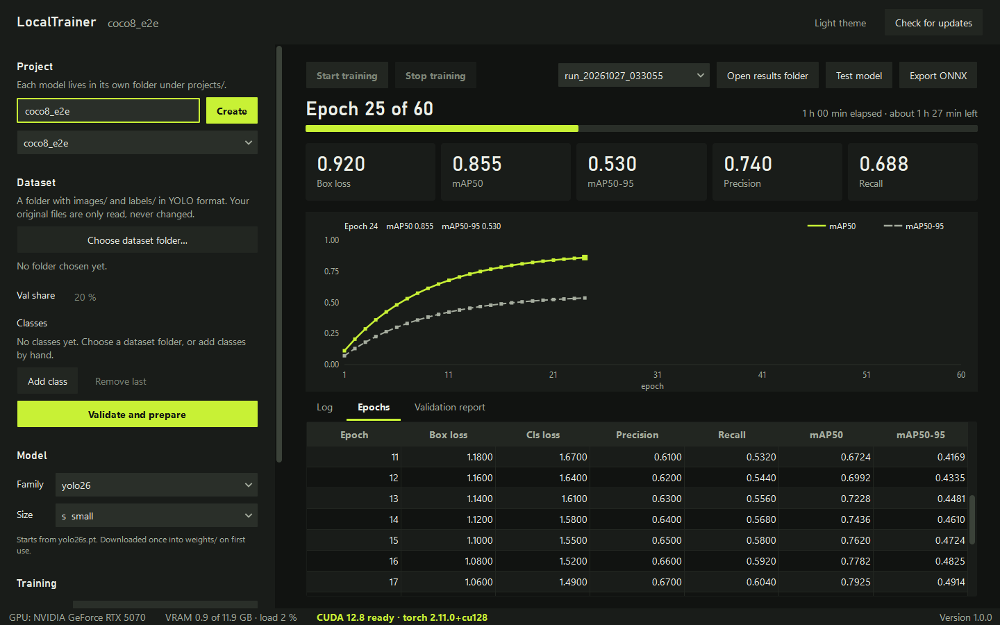

# LocalTrainer

LocalTrainer is a Windows desktop app for training YOLO object detection models on your own GPU. You pick a labelled dataset, choose a model and press Start training. It runs [Ultralytics](https://docs.ultralytics.com) underneath, so you never open a terminal.



## What it does

- Creates one folder per model under `projects/<name>/` and keeps every run in its own `runs/run_<timestamp>/` folder, so a new run never overwrites an old one.
- Accepts a dataset that is already split (`images/train`, `images/val`, `labels/train`, `labels/val`) or a flat `images/` + `labels/` pair, which it splits 80/20 with a fixed seed.
- Copies the dataset into the project. Your original folder stays untouched.
- Reads class names from `classes.txt` or `data.yaml`, or lets you type them.
- Checks every label before training: missing labels, class ids out of range, values outside 0 to 1. Errors block training until you fix them.
- Shows live progress, the Ultralytics log, box loss, precision, recall, mAP50 and mAP50-95 per epoch, and a mAP50 chart.
- Tests the best weights on an image, a folder or a video and opens the annotated result.
- Exports the best weights to ONNX.
- Updates itself from GitHub releases with a SHA-256 check and automatic rollback.

## Requirements

- Windows 10 or 11
- Python 3.12 or 3.13 from [python.org](https://www.python.org/downloads/)
- An NVIDIA GPU with a current driver. RTX 50-series (Blackwell) cards need the CUDA 12.8 PyTorch build, which `setup.bat` installs. Without a GPU, LocalTrainer trains on the CPU and warns you.
- About 6 GB of free disk space for PyTorch and the packages

## Setup

1. Download `LocalTrainer-<version>.zip` from the [latest release](https://github.com/EQQX0/LocalTrainer/releases/latest) and unzip it, or clone the repository.
2. Double-click `setup.bat`. It creates `.venv`, installs PyTorch with CUDA 12.8, then installs `requirements.txt`. The first run downloads about 3 GB.
3. Double-click `run.bat` to start LocalTrainer.

If you prefer the command line, setup runs these commands:

```bat
py -3.13 -m venv .venv
.venv\Scripts\python.exe -m pip install torch torchvision --index-url https://download.pytorch.org/whl/cu128
.venv\Scripts\python.exe -m pip install -r requirements.txt
```

## Usage walkthrough

1. **Name the model.** Type a name such as `helmets` and press Create. Names may use letters, digits, `-` and `_`. If the project exists, LocalTrainer offers to open it.
2. **Choose the dataset folder.** Point it at the folder that holds `images/` and `labels/`. The sidebar shows the layout it found. For a flat folder, set the val share (20 % by default).
3. **Check the classes.** LocalTrainer fills the list from `classes.txt` or `data.yaml`. Without either file, it counts the class ids in your labels and asks you to name each one, in id order.
4. **Validate and prepare.** LocalTrainer checks every image and label and shows a report with boxes per class, missing labels and invalid files. A clean dataset gets copied to `projects/<name>/dataset/`, and LocalTrainer writes `projects/<name>/data.yaml` with absolute paths.
5. **Pick the model and settings.** Family (yolo26, yolo11, yolov8) and size (n, s, m, l, x) build the weights name, for example `yolo26s.pt`. The defaults are 100 epochs, 640 px, batch 16, 4 workers and patience 50. Tick Auto to let Ultralytics choose the batch size. Hover any setting for an explanation.
6. **Start training.** The progress bar, log, metric tiles and chart update live. The window stays responsive because training runs in a separate process.
7. **Stop if you need to.** Stop training finishes the current batch, validates, and saves `last.pt` and `best.pt`. Press it a second time to force stop; the run keeps any weights saved so far.
8. **Use the result.** Open results folder shows the run. Test model runs `best.pt` on an image, a folder or a video. Export ONNX writes `best.onnx` next to `best.pt`.

Your settings live in `projects/<name>/settings.json` and come back when you reopen the project.

### Keyboard shortcuts

| Keys | Action |
| --- | --- |
| Ctrl+N | Focus the model name |
| Ctrl+O | Choose the dataset folder |
| F5 | Validate and prepare |
| Ctrl+Enter | Start training |
| Ctrl+. | Stop training (twice to force) |
| Ctrl+R | Open the results folder |
| Ctrl+T | Test model |
| Ctrl+E | Export ONNX |
| Ctrl+U | Check for updates |
| Ctrl+Shift+L | Switch dark and light theme |

Tab moves through every control. On the chart, use the arrow keys to read values epoch by epoch.

## Troubleshooting

**"Training will run on the CPU".** PyTorch cannot use your GPU. Run this in the LocalTrainer folder, then restart the app:

```bat
.venv\Scripts\python.exe -m pip install --force-reinstall torch torchvision --index-url https://download.pytorch.org/whl/cu128
```

**Out of GPU memory.** Halve the batch size, or lower the image size to 512 or 416 px, or pick a smaller model size. The error banner has a button that halves the batch for you.

**Training hangs before the first epoch.** Windows dataloader workers sometimes stall. LocalTrainer notices after 4 minutes without a batch and restarts the run with `workers = 0`. You can also set Workers to 0 yourself.

## Updates

LocalTrainer checks GitHub quietly at startup and marks the Check for updates button when a new version exists. Click it to read the release notes, then choose Update now. LocalTrainer then:

1. downloads the release zip with a progress bar,
2. verifies its SHA-256 checksum,
3. unpacks it to a temporary folder,
4. closes, and a small helper backs up the current app files to `update_backups/`, copies in the new ones and restarts LocalTrainer,
5. runs `pip install -r requirements.txt` in `.venv` if `requirements.txt` changed.

If any step fails, the helper restores the backup and LocalTrainer tells you on the next start. The updater never touches `projects/`, `settings.json`, `.venv` or downloaded weights, and it needs no admin rights. It also handles no internet, GitHub's rate limit of 60 checks per hour and a release without assets.

## Publishing a release

1. Bump `__version__` in `app/version.py`, for example to `1.0.1`.
2. Commit: `git commit -am "Release 1.0.1"`.
3. Tag: `git tag v1.0.1`.
4. Push both: `git push origin main` and `git push origin v1.0.1`.

The GitHub Actions workflow in `.github/workflows/release.yml` runs the tests, builds `LocalTrainer-1.0.1.zip` (app code only, no venv, projects or models) with `tools/build_release.py`, writes `LocalTrainer-1.0.1.zip.sha256`, and publishes both on a new release with generated notes. The workflow fails if the tag and `app/version.py` disagree.

PyTorch with CUDA is several GB, above GitHub's 2 GiB asset limit, so releases ship source only and `setup.bat` installs PyTorch on your machine.

## Project layout

```
main.py                 entry point (main guard for Windows multiprocessing)
app/version.py          the version number, kept in one place
core/dataset.py         layout detection, validation, flat-to-split copy
core/yaml_gen.py        data.yaml generation
core/trainer.py         training config, Ultralytics callbacks, Qt session
core/predictor.py       Test model and ONNX export
core/jobs.py            worker process runner and output parser
core/worker.py          code that runs in the worker process
core/updater.py         release check, download, checksum, extraction
core/env_check.py       CUDA and RTX 50-series support check
core/gpu_monitor.py     live VRAM readout from nvidia-smi
ui/                     main window, widgets, theme tokens and stylesheet
utils/update_helper.py  replaces app files, rolls back on failure
tests/                  unit tests (pytest)
tools/build_release.py  builds the release zip and checksum
```

## Development

```bat
.venv\Scripts\python.exe -m pip install -r requirements-dev.txt
.venv\Scripts\python.exe -m pytest
```

## License

MIT. See [LICENSE](LICENSE). Ultralytics itself uses the AGPL-3.0 license; read its terms before you ship trained models in a commercial product.
